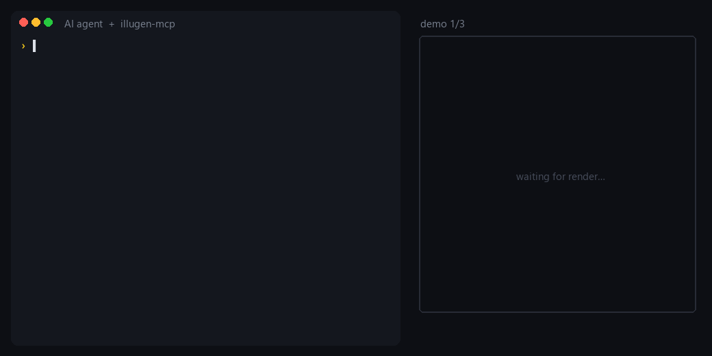

<div align="center">

# IlluGen MCP

### Let your AI agent build, edit and render [JangaFX IlluGen](https://jangafx.com/software/illugen) node graphs.

Describe a texture, a VFX flipbook or a procedural mask in plain words: your agent creates the
`.illugen` project, wires the nodes, checks it and renders it with **your own IlluGen**. No clicks, no window.

[](LICENSE)
[](pyproject.toml)
[](https://modelcontextprotocol.io)
[](#requirements)
[](https://github.com/dokaNc/illugen-mcp/actions)

[Quick start](#quick-start) · [What it can do](#what-it-can-do) · [Tools](#tools) · [How it works](#how-it-works) · [FAQ](#faq)

<br />



<sub>Real tool calls and timings, real IlluGen renders. Reproduce them with <a href="examples/demo_scenes.py"><code>examples/demo_scenes.py</code></a>.</sub>

</div>

---

## Quick start

### 1. Requirements

- **Windows** with **IlluGen 1.2.x** installed and activated (a valid JangaFX license: this project does not
  include or replace IlluGen).
- **Python 3.10+**. [`uv`](https://docs.astral.sh/uv/) is recommended (no manual install needed).

### 2. Add it to your agent

**Claude Code**

```bash
claude mcp add illugen -s user -- uvx --from git+https://github.com/dokaNc/illugen-mcp illugen-mcp
```

**Claude Desktop, Cursor, Windsurf, VS Code, Gemini CLI…** (any MCP client): add this to the client's
MCP configuration (`claude_desktop_config.json`, `.cursor/mcp.json`, …):

```json
{
  "mcpServers": {
    "illugen": {
      "command": "uvx",
      "args": ["--from", "git+https://github.com/dokaNc/illugen-mcp", "illugen-mcp"]
    }
  }
}
```

<details>
<summary>Without uv (plain pip)</summary>

```bash
pip install git+https://github.com/dokaNc/illugen-mcp
claude mcp add illugen -s user -- illugen-mcp
```

or `"command": "illugen-mcp"` in the JSON configuration.
</details>

<details>
<summary>IlluGen installed somewhere else?</summary>

Set `ILLUGEN_EXE` to the full path of `IlluGen.exe`:

```bash
claude mcp add illugen -s user -e ILLUGEN_EXE="D:\Apps\IlluGen\IlluGen.exe" -- uvx --from git+https://github.com/dokaNc/illugen-mcp illugen-mcp
```

```json
"env": { "ILLUGEN_EXE": "D:\\Apps\\IlluGen\\IlluGen.exe" }
```
</details>

### 3. Ask

Restart your agent, then try:

```text
Check that IlluGen is reachable with illugen_status, then build me a tileable stone mask
and render it to C:\Users\me\Desktop\stone.
```

## What it can do

- **Build graphs from scratch**: all **157 node types** of IlluGen 1.2.1 (Grayscale, Color, UV, Geometry,
  Islands, Utils, signals, import/export…), with their real defaults, every legal enum value, ranges,
  units and descriptions.
- **Wire them safely**: pin types (Grayscale, Color, UV, Normal, Islands, GeometryBuffer…) are checked
  *before* IlluGen sees the file, and the error suggests a converter node when types don't match.
- **Go beyond plain parameters**: curves, color gradients, spline / lattice control points, subgraphs with
  exposed parameters, signal modulation (Oscillator → `Scale`…), framed groups and notes.
- **Start from the shipped examples**: copy any of IlluGen's 120+ example presets and modify it.
- **Validate for real**: `project_validate(engine=true)` loads the project in IlluGen, runs a trial export
  and reports dropped nodes or links, log errors and a screenshot of any warning dialog.
- **Render**: `project_render` runs File › Export on every export node (PNG, JPG, TGA, EXR, HDR, RAW, R16,
  R8, OBJ, FBX, flipbook sequences…), returns the produced files and an inline preview.
- **Stay out of your way**: rendering uses a private, invisible IlluGen instance. An IlluGen you have open
  keeps running untouched, and nothing steals your mouse or keyboard focus.

## Tools

| Tool | What it does | Starts IlluGen? |
|---|---|---|
| `illugen_status` | Installation, running instances, catalog version | no |
| `list_node_types`, `describe_node_type` | Browse node types; parameters, defaults, enums, typed pins, curves | no |
| `list_presets` | IlluGen's shipped example projects | no |
| `project_new` | Empty project, or an editable copy of a preset | no |
| `project_summary`, `node_get` | Read the graph (nodes, links, settings, curves, gradients…) | no |
| `node_add`, `node_set`, `node_remove` | Edit nodes (values validated against IlluGen's definitions) | no |
| `link_add`, `link_remove` | Connections, parameter pins, optional inputs, modulation ranges | no |
| `curve_set`, `gradient_set`, `spline_set` | Curves, gradients, control points | no |
| `subgraph_expose_param` | Expose an inner parameter on a subgraph node | no |
| `annotation_add`, `annotation_remove` | Framed groups and notes | no |
| `project_set_settings` | FPS, loop region, default texture size | no |
| `node_set_data` | Raw access to any other node field | no |
| `project_thumbnail` | Thumbnail embedded in the file | no |
| `project_validate` | Offline checks; with `engine=true`, a real load + trial export | with `engine=true` (~5 s) |
| `project_render` | Export everything, optionally to `output_dir`; files + preview | yes (~7 s) |
| `project_screenshot` | Screenshot of the project open in IlluGen (viewport + graph) | yes |
| `project_normalize` | Load + save in IlluGen (fills defaults, refreshes the thumbnail), keeps a `.bak` | yes |

Typical flow: `project_new` → `node_add` … → `link_add` … → `project_validate(engine=true)` → `project_render`.

## Showcase


Lava (Voronoi noise → levels → color ramp → glow), caustics (polygon fractal → caustics → ramp) and an energy
web (Voronoi edges → ramp → glow): 4 to 5 nodes each, built and rendered by the agent in about 15 seconds.
The exact graphs are in [`examples/demo_scenes.py`](examples/demo_scenes.py).

## Example prompts

```text
Open the "brick_wall" preset, make it 2048x2048, make the bricks darker and render it.
```
```text
Create a 64-frame looping smoke flipbook (8x8 atlas), export as TGA to D:\fx\smoke.
```
```text
Build a subgraph "edge wear" (noise + levels + blur) with its seed exposed, use it twice with
different seeds and blend the results.
```
```text
Explain what every node in C:\projects\lava.illugen does and suggest how to make it less noisy.
```

## How it works

- **Editing happens directly on the file.** `.illugen` projects are read and written losslessly (a file
  saved without changes is byte-identical), so offline edits are instant and safe. Node definitions come
  from bundled tables matching IlluGen 1.2.1.
- **Rendering uses IlluGen itself.** The server starts a private copy of IlluGen in its own folder,
  hidden from the screen and the taskbar, loads the project and triggers IlluGen's own export
  shortcut. It follows progress through IlluGen's log and closes it when done. Your settings and open
  IlluGen windows are not touched.
- **Errors come back to the agent.** Failed exports and loading warnings are detected and returned with a
  screenshot, so the agent can fix the graph by itself.

Files written by the server: projects and renders where you ask, plus a scratch folder in
`%LOCALAPPDATA%\illugen-mcp` (override with `ILLUGEN_MCP_HOME`).

## Updating IlluGen

The bundled node tables target IlluGen **1.2.1**. After an IlluGen update, rebuild the catalog from your
installation (takes a few minutes, IlluGen runs invisibly):

```bash
uvx --from git+https://github.com/dokaNc/illugen-mcp python -m illugen_mcp.build_catalog
```

The new catalog is stored in `%LOCALAPPDATA%\illugen-mcp\data` and takes precedence over the bundled one.

## FAQ

**Does it work on macOS or Linux?**
Not yet: rendering drives the Windows build of IlluGen. Offline editing (`project_*`, `node_*`, `link_*`)
is pure Python and should work elsewhere, but only Windows is tested.

**Will it mess with the IlluGen I have open?**
No. Each render runs in its own private instance with its own configuration and recovery file.

**`IlluGen did not finish starting`**
Start IlluGen once by hand (activate the license, close the welcome screen), check the path with
`illugen_status`, and look at the latest log in `%LOCALAPPDATA%\JangaFX\illugen\logs`. If it persists,
[open an issue](https://github.com/dokaNc/illugen-mcp/issues) with that log.

**A render says "Nodes failed to export".**
Usually a graph problem (pin type mismatch, disconnected input). The screenshot returned with the error
shows the node in warning; `describe_node_type` lists the expected pin types.

**I changed IlluGen's keyboard shortcuts.**
Supported: the server reads them from IlluGen's `config.ini`.

## Development

```bash
git clone https://github.com/dokaNc/illugen-mcp
cd illugen-mcp
pip install -e ".[dev]"
pytest                      # tests needing IlluGen are skipped automatically if it isn't installed
ruff check .
```

Contributions are welcome: see [CONTRIBUTING.md](CONTRIBUTING.md).

## Disclaimer

IlluGen MCP is an independent community project. It is **not affiliated with, endorsed by or supported by
JangaFX**. IlluGen and JangaFX are trademarks of their respective owner. You need your own licensed copy of
IlluGen; this project neither includes nor modifies it.

## License

[MIT](LICENSE)
